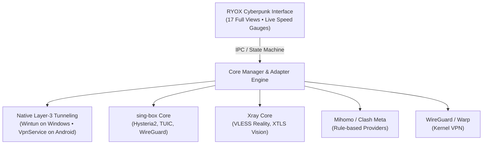

<div align="center">

# RYOX VPN
### The Ultimate Free & Open-Source Multi-Core Anti-Censorship VPN Client
**Windows 10/11 • Android 10+ • 100% Free Forever • Open Source (Apache 2.0)**

[](https://github.com/hidooch980/Ryox-VPN/actions)
[](LICENSE)
[](https://github.com/hidooch980/Ryox-VPN/releases)
[]()
[]()

<br/>

> **RYOX VPN** is an ultra-modern, professional-grade VPN and proxy client engineered from the ground up to circumvent censorship, preserve privacy, and deliver blistering connection speeds without paywalls or subscriptions.

</div>

---

## 🌟 Our Absolute Guarantee: 100% Free Forever

RYOX VPN is built under an uncompromising open-source philosophy. It will **never** charge users:
- ❌ **No Paid Subscriptions** or VIP tiers
- ❌ **No Advertisements** or sponsor popups
- ❌ **No Paywalls** or trial periods
- ❌ **No Artificial Speed or Data Caps**
- ❌ **No Secret Traffic Routing or Selling**
- ✔️ **100% Free & Open Source Forever under Apache 2.0**

---

## 🚀 Key Architectural Highlights



- **Modular Multi-Core System**: Automatically routes connections to the optimal underlying binary (`sing-box`, `Xray-core`, `Mihomo`, `Hysteria 2`, or `WireGuard`).
- **Complete Protocol Coverage**:
  - **VLESS Reality** with `xtls-rprx-vision` flow and uTLS fingerprint spoofing (`chrome`, `safari`, `firefox`).
  - **Hysteria 2** & **TUIC** for maximum throughput over UDP under lossy network conditions.
  - **VMess**, **Trojan TLS**, **Shadowsocks 2022 AEAD**, and **WireGuard**.
- **Native OS Tunneling**:
  - **Windows**: High-performance Layer-3 Wintun driver (`ryox-tun`) and WinINet system proxy modes.
  - **Android**: Full native `VpnService` with Quick Settings status tile for 1-tap connection.
- **Smart Routing & Anti-Censorship**:
  - GeoIP and Geosite automatic routing (Bypass local services, bypass China/Iran LAN).
  - Built-in ad & malware tracker blocker (`geosite:category-ads-all`).
  - DNS-over-HTTPS (DoH) encrypted resolvers (`Cloudflare`, `Google`, `Quad9`).
- **Public Free Configuration Discovery**:
  - Scrapes, validates, and deduplicates open-source community node feeds from GitHub and GitLab.
  - Built-in real-time latency ping testing.
- **Automatic GitHub Releases Updates**:
  - Automated version checking with mandatory SHA256 checksum verification.

---

## 📱 17 Dedicated User Interface Pages

1. **Dashboard**: Animated cyber connect button, live upload/download speed gauges, session timer, and live bandwidth graph.
2. **Servers**: Complete server management, search, protocol filtering, and latency testing.
3. **Subscriptions**: Automatic remote subscription feeds (Base64, Clash YAML, sing-box JSON).
4. **Free Sources**: Curated anti-censorship open repository discovery with 1-click sync.
5. **Core Manager**: Binary management, status inspection, and active engine selection.
6. **Protocol Manager**: Feature matrix and cipher explanations.
7. **Config Editor**: Live compiler & runtime JSON/YAML inspector.
8. **Routing Rules**: Rule-based, Global, or Direct traffic steering.
9. **DNS Settings**: Custom DNS, DoH, and leak prevention.
10. **Split Tunneling**: App-based routing (Bypass or Proxy specific apps).
11. **Network Diagnostics**: Virtual IP lookup, ISP detection, and DNS leak audits.
12. **Connection Logs**: Live streaming console with severity level filters and export.
13. **App Updates**: Automated GitHub releases checker.
14. **Core Updates**: Upstream binary sync with SHA256 verification.
15. **Appearance**: Cyberpunk neon, dark graphite, and clean daylight themes.
16. **Settings**: Kill switch, TUN/Proxy toggle, LAN sharing, auto-connect on boot.
17. **About Ryox**: Project manifesto, license links, and contributor credits.

---

## 🛠️ Building & Running from Source

### Prerequisites
- Node.js 22+ & npm 10+
- OpenJDK 17+ (for Android builds)

### 1. Windows Desktop Client

```bash
# Clone the repository
git clone https://github.com/hidooch980/Ryox-VPN.git
cd Ryox-VPN

# Install dependencies
npm install

# Run automated tests
npm run test

# Launch in developer mode
npm run dev

# Compile production build
npm run build
```

### 2. Android APK Build

```bash
cd android
./gradlew assembleRelease
# Output: android/app/build/outputs/apk/release/app-release.apk
```

---

## 🔒 Security & Privacy

- **Zero Logging**: RYOX VPN does not collect or log connection timestamps, visited domains, or transferred content.
- **Leak Protection**: Automatic Kill Switch drops non-tunnel traffic if the VPN connection drops.
- **Encrypted DNS**: Prevents ISP DNS manipulation and censorship injection.

---

## 📜 Legal & Open Source Compliance

RYOX VPN is released under the **Apache License 2.0**.
See [LICENSE](LICENSE) and [THIRD_PARTY_LICENSES.md](THIRD_PARTY_LICENSES.md) for full attributions and third-party upstream projects (`sing-box`, `Xray-core`, `Mihomo`, `WireGuard`, `Wintun`).
